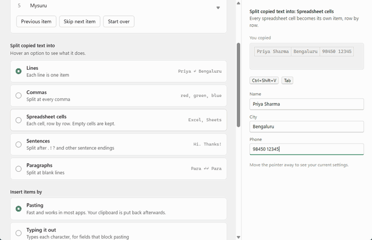
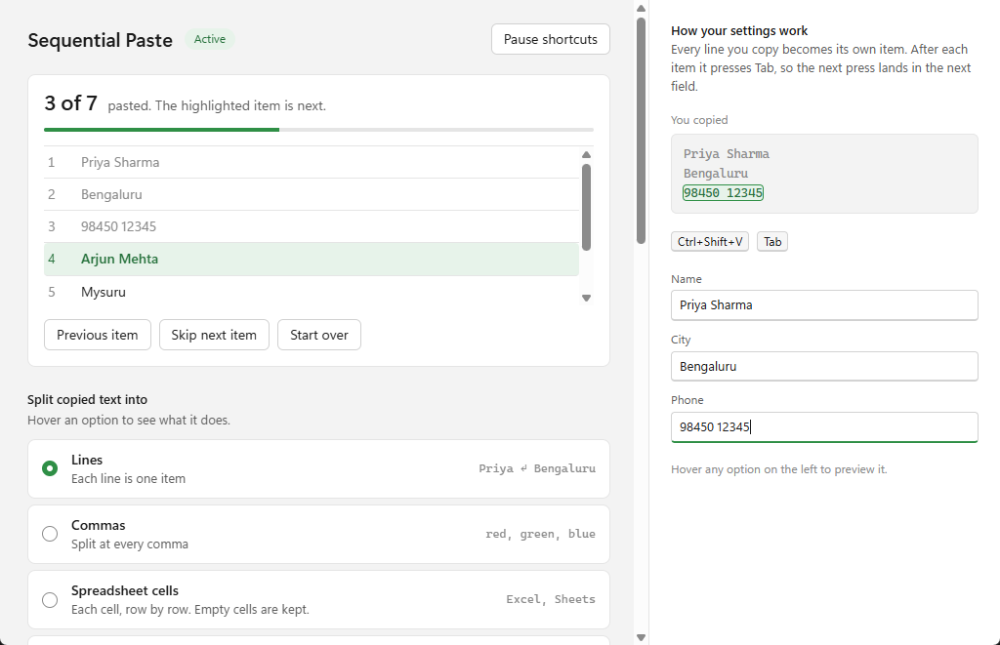
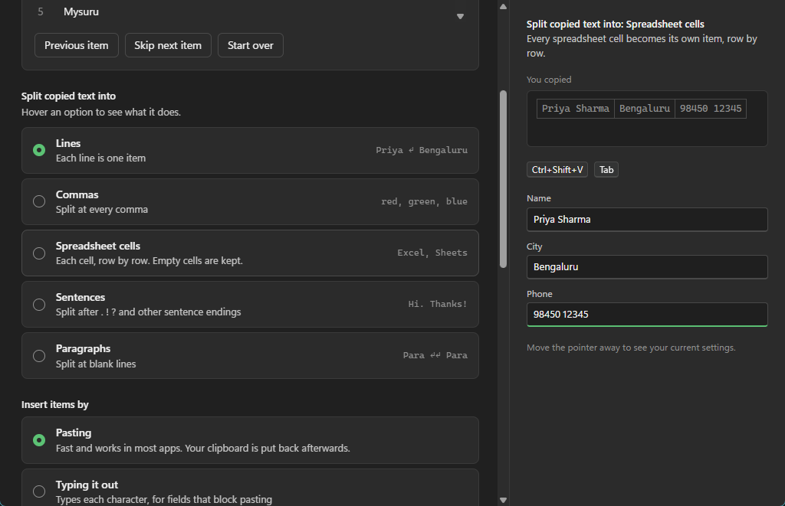
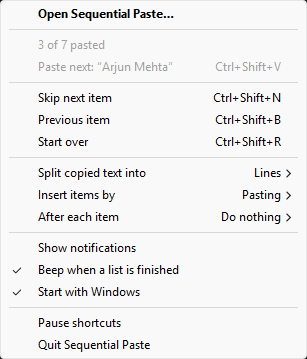

<p align="center">
  
</p>

<h1 align="center">Sequential Paste</h1>

<p align="center">
  Copy a list once, then paste it one item at a time.<br>
  A small Windows utility for filling in forms, spreadsheets and anything else that wants one value per field.
</p>

<p align="center">
  <a href="https://github.com/imsayanpaul/sequential-paste/raw/main/installer/SequentialPaste_Setup_v1.0.0.exe"><b>Download the installer</b></a>
  &nbsp;·&nbsp;
  <a href="https://github.com/imsayanpaul/sequential-paste/raw/main/dist/SequentialPaste.exe">Portable exe</a>
  &nbsp;·&nbsp;
  Windows 10 and 11
  &nbsp;·&nbsp;
  MIT license
</p>

<p align="center">
  
</p>

---

## The problem

You have a list of 30 names, or a row of cells from a spreadsheet, and each value has to go into its own field. Normally that means switching windows and copying every value separately.

With Sequential Paste you copy the whole list once. Every press of `Ctrl+Shift+V` pastes the next item.

## How it works

1. **Copy a list**: several lines, comma-separated values, or cells from Excel or Google Sheets.
2. **Click** where the first item should go.
3. **Press `Ctrl+Shift+V`**. The first item is pasted. Press it again for the second, and so on.

Filling in a form? Set **After each item** to **Press Tab**. Each paste then moves on to the next field, so you can fill the whole form by pressing `Ctrl+Shift+V` over and over.

## The app window

Click the tray icon to open it. It shows the list you copied, with what's already pasted and what's next, and every setting with a short explanation. Hover any option and the preview on the right acts it out on a sample list and form, as in the animation above.

<table>
  <tr>
    <td></td>
    <td></td>
  </tr>
</table>

It follows the Windows light or dark theme, opens once on first run, and closing it keeps the app running in the tray.

## The tray menu



Everything is also one right-click away:

- what's been pasted and the next item
- skip, go back or start over
- the three settings, with the current choice shown
- notifications, the end-of-list beep, Start with Windows
- pause the shortcuts

The tray icon turns grey while paused and shows a check mark once every item has been pasted.

<br clear="right">

## Shortcuts

| Shortcut | Action |
|----------|--------|
| `Ctrl+Shift+V` | Paste the next item |
| `Ctrl+Shift+N` | Skip the next item |
| `Ctrl+Shift+B` | Go back one item |
| `Ctrl+Shift+R` | Start over |
| Hold `Esc` | Stop typing (when typing it out) |

The shortcuts only act while a list is loaded. When the clipboard holds a single item, or the shortcuts are paused, they go to the app you're using as normal, so `Ctrl+Shift+V` still pastes plain text in your browser and `Ctrl+Shift+N` still opens a private window.

## Settings

**Split copied text into**

| Option | You copy | Items |
|--------|----------|-------|
| Lines | `Priya Sharma` ↵ `Bengaluru` | `Priya Sharma`, `Bengaluru` |
| Commas | `red, green, blue` | `red`, `green`, `blue` |
| Spreadsheet cells | A range of cells | Each cell, row by row. Empty cells are kept so fields stay lined up. |
| Sentences | `Hi Priya. Your order shipped.` | `Hi Priya.`, `Your order shipped.` |
| Paragraphs | Text separated by blank lines | One item per paragraph |

Sentence splitting understands abbreviations (Mr., Dr., e.g.), decimals, URLs, email addresses and ellipses, and also splits on Hindi (।), Chinese and Japanese (。！？) and Arabic (؟) sentence endings.

**Insert items by**

- **Pasting**: fast, and works in most apps. Your own clipboard is put back after each paste.
- **Typing it out**: types each character, for fields that block pasting.

**After each item**: do nothing, press Tab to jump to the next field, or press Enter for a new line.

## Install

- **Installer**: [SequentialPaste_Setup_v1.0.0.exe](https://github.com/imsayanpaul/sequential-paste/raw/main/installer/SequentialPaste_Setup_v1.0.0.exe). Installs for your user account, with an option to start with Windows.
- **Portable**: [SequentialPaste.exe](https://github.com/imsayanpaul/sequential-paste/raw/main/dist/SequentialPaste.exe). No installation; run it from anywhere.

The app window uses the Microsoft Edge WebView2 runtime, which comes with Windows 11 and current Windows 10. Without it, everything still works from the tray menu.

Settings are stored in `%APPDATA%\Sequential Paste\settings.json`, and errors are logged to `error.log` in the same folder.

## Run from source

Requires Python 3.10 or newer.

```bash
git clone https://github.com/imsayanpaul/sequential-paste.git
cd sequential-paste
pip install -r requirements.txt
python main.py
```

```bash
python -m unittest discover -s tests   # run the tests
python build.py                        # build dist/SequentialPaste.exe
```

The installer is built from `installer.iss` with [Inno Setup](https://jrsoftware.org/isinfo.php). To work on the app window's page, open `ui/index.html` in a browser: without the app it runs on built-in sample data.

| File | Purpose |
|------|---------|
| `main.py` | Entry point, single-instance check, starts the tray and window |
| `clipboard_manager.py` | Splits text into items and tracks the position |
| `hotkey_handler.py` | Global shortcuts, clipboard monitoring, pasting and typing |
| `tray_icon.py` | Tray icon and menu |
| `app_window.py`, `ui/index.html` | App window and its previews (pywebview) |
| `notification.py` | Notifications and sounds |
| `settings_manager.py` | Settings file and the Start with Windows entry |
| `error_logger.py` | Error log |
| `config.py` | Constants |
| `tools/make_logo.py` | Renders the logo to the app icon and the website icons |
| `website/` | The download site (Next.js, Tailwind, Framer Motion) |

### Website

```bash
cd website
npm install
npm run dev        # http://localhost:3000
```

It deploys on Vercel: import the repo and set the project's **Root Directory** to `website`.

## License

MIT. See [LICENSE](LICENSE).
