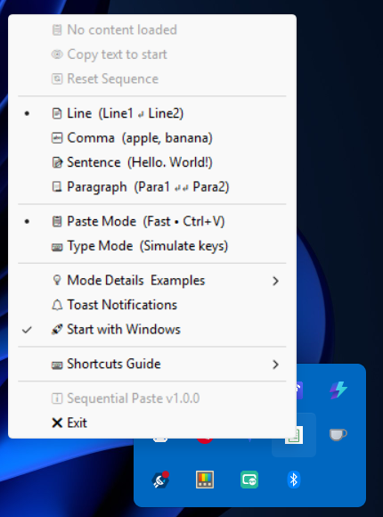

<p align="center">
  
</p>

<h1 align="center">Sequential Paste</h1>

<p align="center">
  <b>Paste text one segment at a time — line by line, comma by comma, sentence by sentence.</b>
  <br>
  A lightweight Windows utility that turns any copied text into a sequential paste queue.
</p>

<p align="center">
  
  
  
  
</p>

<p align="center">
  
</p>

---

## ❓ The Problem

You copy a list of 50 usernames or comma-separated values. Now you need to paste them **one at a time** into 50 separate fields. Normally, you'd go back and forth copying each line or item individually.

**Sequential Paste fixes this.** Copy once, paste sequentially.

## ⚡ How It Works

1. **Copy** any text (a list, comma-separated values, paragraph, or document)
2. Press **`Ctrl+Shift+V`** → pastes the **1st segment**
3. Press again → pastes the **2nd segment**
4. And so on...

That's it. No UI to manage, no windows to open. It lives in your **system tray** and just works.

## ✨ Features

| Feature | Description |
|---------|-------------|
| 📄 **Four Split Modes** | **Line** (newline), **Comma** (`,` CSV values), **Sentence** (`. ! ?`), **Paragraph** (blank lines) |
| ⌨️ **Type Mode** | Simulates keystrokes — works on paste-blocked fields (banking sites, exams, forms) |
| 📋 **Paste Mode** | Standard Ctrl+V paste — fast and default |
| ⏭️ **Skip & Go Back** | Navigate through segments freely with `Ctrl+Shift+N` and `Ctrl+Shift+B` |
| 🌐 **Multi-language** | Supports Hindi (।), Chinese (。), Arabic (؟) sentence endings |
| 🧠 **Smart Splitting** | Handles abbreviations (Mr., Dr.), URLs, emails, decimals, ellipsis |
| 💾 **Persistent Settings** | Remembers your preferences between sessions |
| 🚀 **Startup with Windows** | Optional auto-start on boot |
| 🔒 **Single Instance** | Prevents duplicate instances from running |
| 📝 **Error Logging** | Logs errors to AppData for easy debugging |

## 🔤 Split Modes Explained

| Mode | Example Input | Output Segments |
|------|---------------|-----------------|
| 📄 **Line** | `Line 1\nLine 2\nLine 3` | `'Line 1'` ➔ `'Line 2'` ➔ `'Line 3'` |
| 🔤 **Comma** | `apple, banana, cherry` | `'apple'` ➔ `'banana'` ➔ `'cherry'` |
| 📝 **Sentence** | `Hello. How are you? Fine!` | `'Hello.'` ➔ `'How are you?'` ➔ `'Fine!'` |
| 📃 **Paragraph** | `Para 1\n\nPara 2` | `'Para 1'` ➔ `'Para 2'` |

## ⌨️ Keyboard Shortcuts

| Shortcut | Action |
|----------|--------|
| `Ctrl+Shift+V` | Paste next segment |
| `Ctrl+Shift+N` | Skip current segment |
| `Ctrl+Shift+B` | Go back to previous segment |
| `Ctrl+Shift+R` | Reset sequence to start |

## 🎯 Use Cases

- **Data Entry** — Paste names, codes, or IDs into separate form fields
- **Customer Support** — Paste template responses one line at a time
- **Developers** — Paste code snippets or config values sequentially
- **Students** — Fill out forms with pre-prepared answers
- **Banking/Exams** — Use Type Mode on paste-blocked fields

## 📥 Installation

### Option 1: Installer (Recommended)
Download `SequentialPaste_Setup_v1.0.0.exe` from [Releases](../../releases) and run the setup wizard.

### Option 2: Portable
Download `SequentialPaste.exe` from [Releases](../../releases) — no installation needed, just run it.

### Option 3: From Source
```bash
git clone https://github.com/imsayanpaul/sequential-paste.git
cd sequential-paste
pip install -r requirements.txt
python main.py
```

## 🛠️ Building from Source

```bash
pip install pyinstaller
python build.py
# Output: dist/SequentialPaste.exe
```

## 📁 Project Structure

```
├── main.py              # Entry point, single-instance lock
├── clipboard_manager.py # Core text splitting & sequence logic
├── hotkey_handler.py    # Global hotkey registration
├── tray_icon.py         # System tray UI and menu
├── notification.py      # Toast notifications & sounds
├── settings_manager.py  # Persistent settings (JSON + registry)
├── error_logger.py      # Error logging to AppData
├── config.py            # App configuration & constants
├── build.py             # PyInstaller build script
├── installer.iss        # Inno Setup installer script
└── assets/
    └── icon.png         # App icon
```

## 🔧 Requirements

- Windows 10/11
- Python 3.10+ (for running from source)

### Dependencies
```
keyboard
pyperclip
pystray
Pillow
plyer
psutil
pyinstaller  # for building
```

## 📋 Type Mode vs Paste Mode

| | Paste Mode (default) | Type Mode |
|---|---|---|
| **Speed** | ⚡ Instant | 🐢 Slower (types each character) |
| **Method** | Ctrl+V clipboard paste | Simulated keystrokes |
| **Blocked fields** | ❌ May be blocked | ✅ Always works |
| **Best for** | Everyday use | Banking, exams, restricted forms |

Switch between modes from the **system tray menu**.

## 🤝 Contributing

Contributions are welcome! Feel free to open issues or submit pull requests.

## 📄 License

MIT License — see [LICENSE](LICENSE) for details.

---
